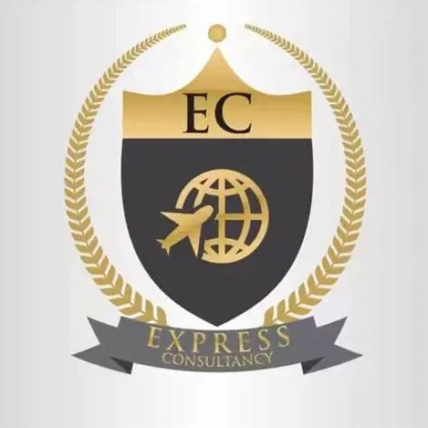

# Express Consultancy — Executive Global Travel & Visa Advisory

A luxury travel consultancy website built with modern web technologies, featuring an **Executive Sovereign** design system, an interactive **Addis Ababa to London / Geneva scroll-linked flight radar animation**, and a direct **Telegram-forwarded Consultation Booking System**.



---

## 🌟 Key Features

1. **Executive Sovereign Luxury Design System**:
   * Palette: Deep Obsidian (`#030612`), Slate Navy (`#1A1F2C`), Sovereign Gold (`#D4AF37`), and Whisper White (`#F8F9FA`).
   * Typography: `EB Garamond` (diplomatic serif headings) paired with `Manrope` (modern geometric UI).
   * Polished elevation, crisp hairline borders, and responsive fluid layout.

2. **🛫 Scroll-Linked Flight Radar Animation**:
   * **Route**: Addis Ababa Bole International (`ADD`) ➔ London Heathrow (`LHR`) / Geneva (`GVA`).
   * **Live Trajectory**: An illuminated Sovereign Gold dashed Bézier arc dynamically draws itself along the page as you scroll.
   * **Supersonic Jet Aircraft**: Rotates to match flight vectors with twin turbofan contrails.
   * **Radar Waypoint Beacons**: Pulsing radar rings mark Addis Ababa, the Red Sea airway corridor, Dubai, and European arrival.
   * **Telemetry HUD Capsule**: A floating glassmorphic pill displaying live route status, scroll progress (0–100%), and altitude (7,625 FT to FL390).

3. **Smart Auto-Hiding Navigation Header**:
   * Automatically translates upwards out of view on scroll down to maximize screen estate.
   * Instantly re-appears on scroll up for effortless access.
   * Responsive mobile drawer navigation with hamburger toggle.

4. **✈️ Telegram Consultation Booking Engine (`book-consultation.html`)**:
   * Multi-step diplomatic client dossier:
     * Full legal passport name, verified email, direct WhatsApp/phone.
     * Nationality and country of residence.
     * Service selection (Executive visas, flight logistics, corporate delegations, student visas).
     * Destination country, target departure date, and expedited urgency (Standard, Diplomatic 3–5 days, Emergency VIP 24–48h).
   * **Instant Telegram Forwarding**: Compiles the submitted dossier into an encrypted, formatted message and launches direct Telegram chat with the agency (`@ExpressConsultancy`).
   * Includes fallback preview modal and copy-to-clipboard functionality.

---

## 📁 Project Structure

```text
Travel Agency/
├── assets/
│   └── logo.jpg               # Official Express Consultancy emblem logo
├── book-consultation.html     # Comprehensive consultation booking & Telegram dispatch portal
├── index.html                 # Main homepage with flight animation, search widget, & services
├── DESIGN_SYSTEM.md           # Full design tokens and style reference guide
└── README.md                  # Project documentation
```

---

## 🚀 Getting Started

Simply open `index.html` in any modern web browser or serve it with any local static server:

```bash
# Using Python
python -m http.server 3000

# Using Node / npx
npx serve .
```

---

## 📜 License & Accreditation

© 2025 Express Consultancy Group S.A. All diplomatic and consular protocols reserved.

